# Animales autóctonos de Uruguay — modelos 3D para imprimir

Este repositorio reúne imágenes y modelos 3D de animales autóctonos de Uruguay. El material fue preparado como recurso educativo para el Colegio Seminario.

## Cómo se crearon los modelos

Esta secuencia fue utilizada para crear los modelos 3D y se puede seguir para crear nuevos modelos:

1. Para cada animal es importante elegir imagenes donde se vea el cuerpo entero (o su mayoría) con claridad. En el caso de no encontrar imagenes de cuerpo entero, algunos modelos de IA pueden copmletar las partes no visibles del cuerpo del animal
2. Luego de obtenida la imagen, se debe eliminar el fondo para obtener una imagen PNG transparente.
3. A partir de cada imagen se puede crear un modelo 3D utilizando la herramienta de [Image to 3D Model de makerworld](https://makerworld.com/en/makerlab/imageTo3d?from=makerlab). Los modelos de este repositorio fueron creados con el modelo "**Rodin Gen-2.5 Medium**". 
4. Luego de generado el modelo, se debe exportar en formato "mesh" para obtener el archivo STL. 
5. Para algunos de los modelos 3D se recomienda imprimir con la [base común](./assets/base.stl) para mayor estabilidad. La base debe agregarse y fusionar con el modelo 3D en el slicer. 

## Catálogo de archivos

En la tabla se puede ver cada animal y acceder directamente a su imagen PNG y a su modelo 3D en formato STL.

| Animal | Vista previa | Imagen | Modelo 3D | Requiere Base | 
|---|:---:|:---:|:---:|:---:|
| Carpincho | 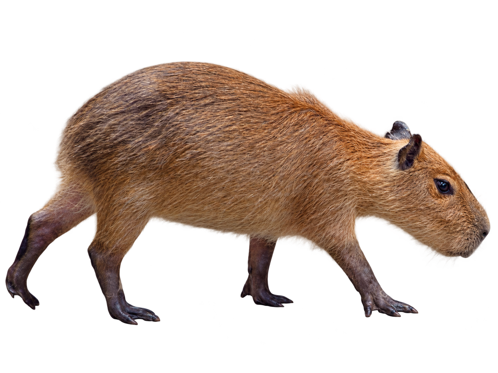 | [Ver o descargar PNG](./assets/carpincho-transparent.png) | [Descargar STL](./assets/carpincho-transparent.stl) | No |
| Coatí | 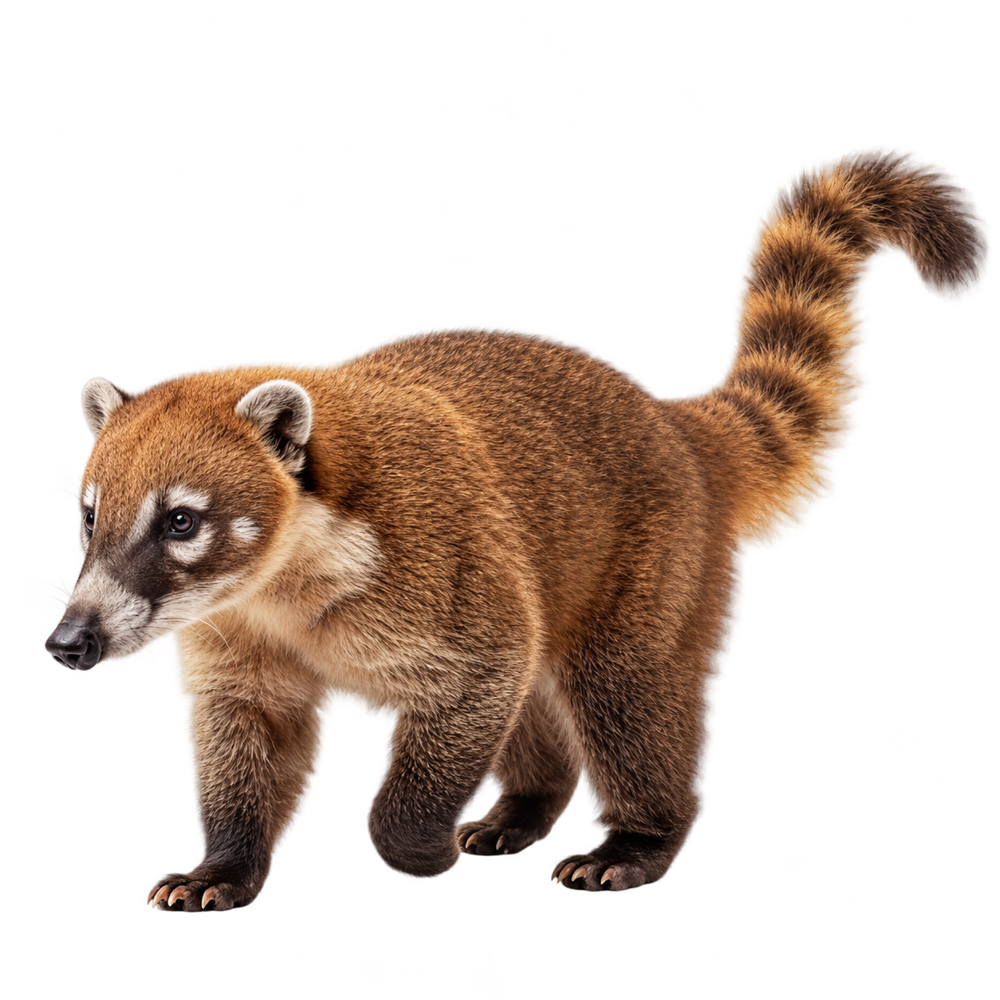 | [Ver o descargar PNG](./assets/coati-transparent.png) | [Descargar STL](./assets/coati-transparent.stl) | No |
| Guazubirá | 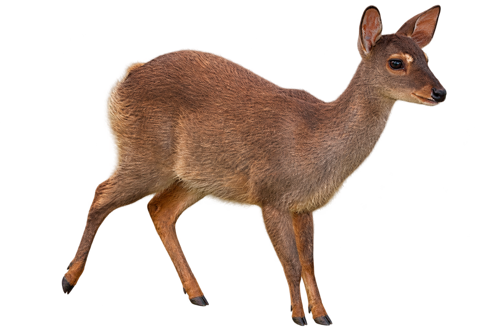 | [Ver o descargar PNG](./assets/guazubira-transparent.png) | [Descargar STL](./assets/guazubira-transparent.stl) | Si |
| Lechuza | 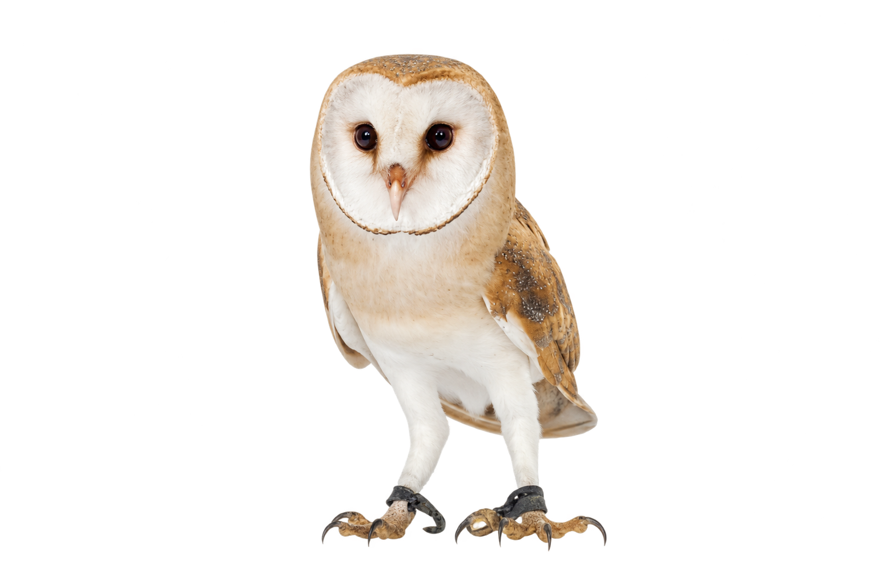 | [Ver o descargar PNG](./assets/lechuza-transparent.png) | [Descargar STL](./assets/lechuza-transparent.stl) | Si |
| Lobito de río | 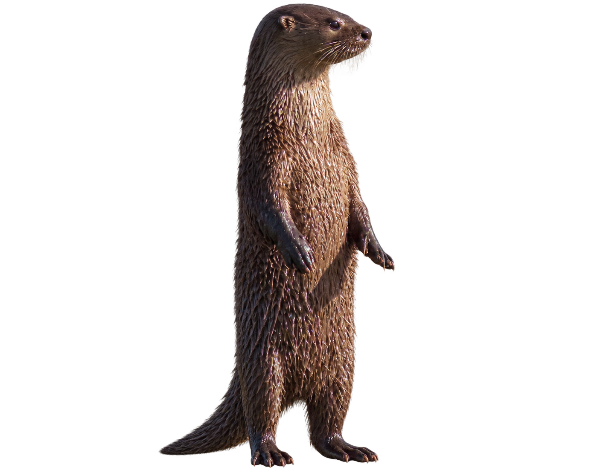 | [Ver o descargar PNG](./assets/lobito-de-rio-transparent.png) | [Descargar STL](./assets/lobito-de-rio-transparent.stl) | No |
| Mano pelada | 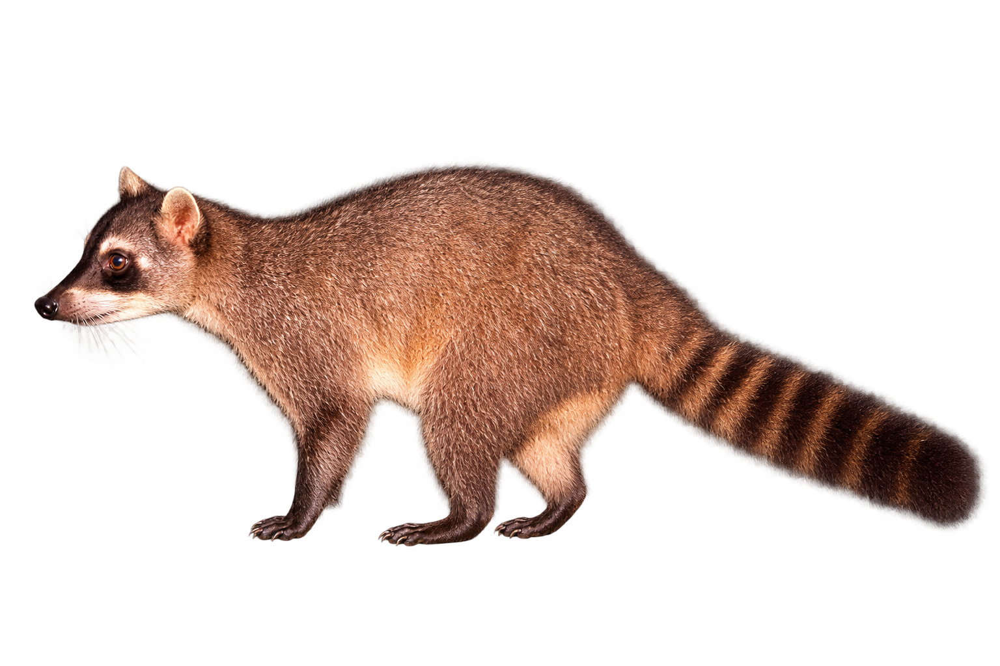 | [Ver o descargar PNG](./assets/mano-pelada-transparent.png) | [Descargar STL](./assets/mano-pelada-transparent.stl) | No |
| Margay | 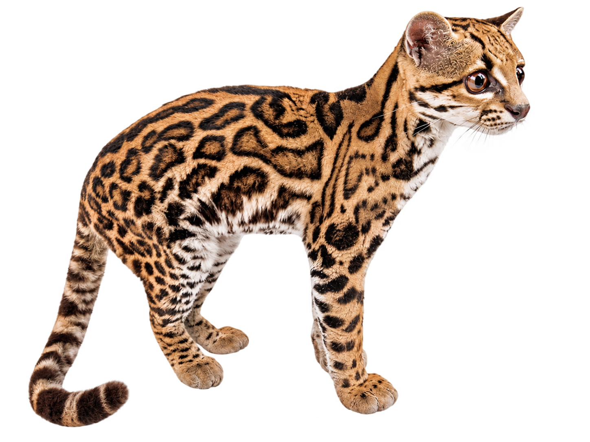 | [Ver o descargar PNG](./assets/margay-transparent.png) | [Descargar STL](./assets/margay-transparent.stl) | No |
| Mulita | 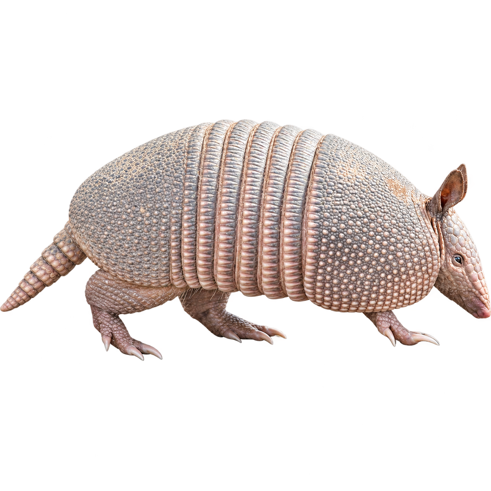 | [Ver o descargar PNG](./assets/mulita-transparent.png) | [Descargar STL](./assets/mulita-transparent.stl) | No |
| Ñandú | 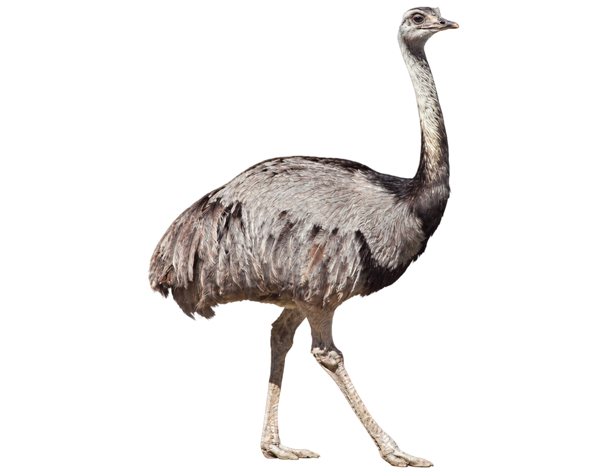 | [Ver o descargar PNG](./assets/nandu-transparent.png) | [Descargar STL](./assets/nandu-transparent.stl) | Si |
| Pecarí | 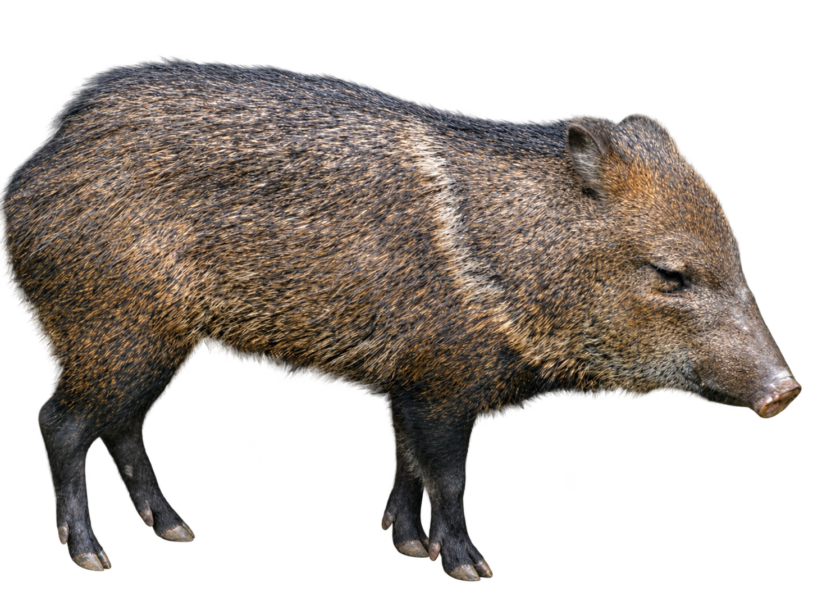 | [Ver o descargar PNG](./assets/pecari-transparent.png) | [Descargar STL](./assets/pecari-transparent.stl) | No |
| Puma | 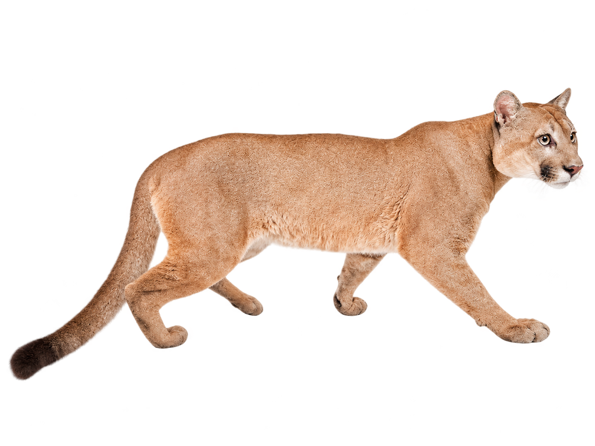 | [Ver o descargar PNG](./assets/puma-transparent.png) | [Descargar STL](./assets/puma-transparent.stl) | No |
| Tero | 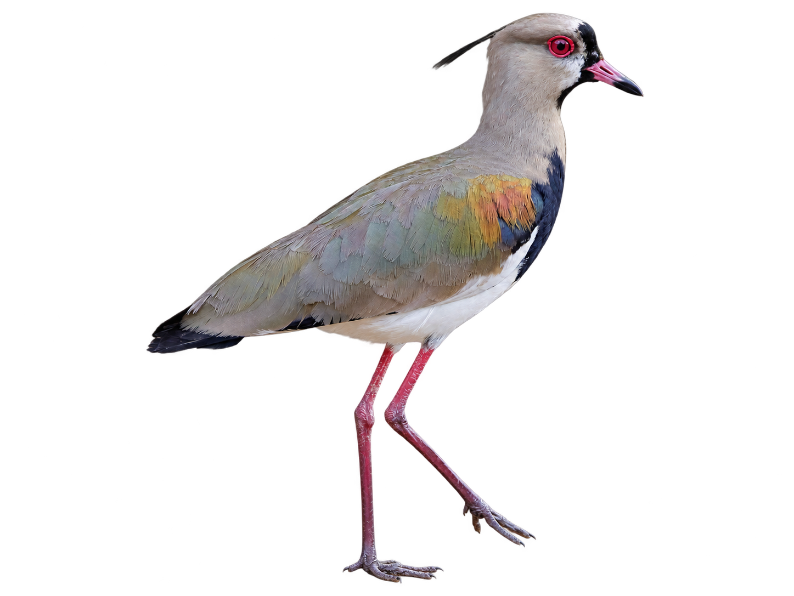 | [Ver o descargar PNG](./assets/tero-transparent.png) | [Descargar STL](./assets/tero-transparent.stl) | Si |
| Yacaré | 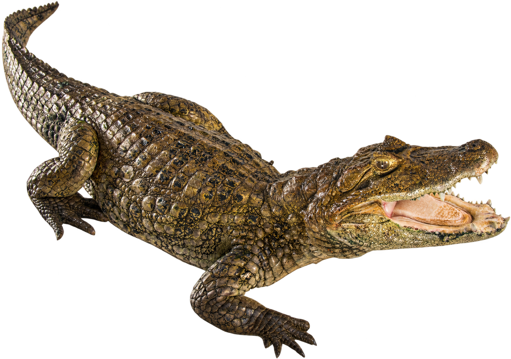 | [Ver o descargar PNG](./assets/yacare-transparent.png) | [Descargar STL](./assets/yacare-transparent.stl) | No |

### Base para los modelos

- [Descargar la base en formato STL](./assets/base.stl)

## Cómo imprimir un modelo

1. Descargá el archivo STL del animal que quieras imprimir.
2. Abrilo en el slicer de la impresora 3D.
3. En caso de requerir base, agregarla y fusionar al modelo a imprimir. 
4. Ajustá la escala y los parámetros de impresión de acuerdo con la impresora y el material que vayas a usar.
5. Laminá el modelo, exportá el archivo de impresión e imprimilo.

Si cambiás el tamaño, te recomendamos mantener las proporciones originales del modelo.

## Organización del repositorio

```text
.
├── assets/      # Imágenes PNG y modelos STL
├── LICENSE
└── README.md
```

## Licencia y atribuciones

El material propio de este repositorio se comparte bajo los términos indicados en el archivo [LICENSE](./LICENSE).

Las fotografías usadas como referencia pueden estar sujetas a las licencias y condiciones de sus autores originales. Antes de reutilizar o redistribuir una imagen, verificá su fuente y conservá la atribución correspondiente.
